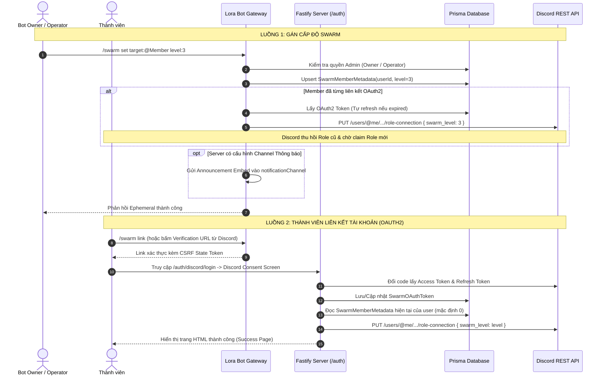

# ĐẶC TẢ YÊU CẦU TÍNH NĂNG (FEATURE REQUIREMENTS DOCUMENT - FRD)
## FEAT-03: SWARM LINKED ROLES & CONNECTION METADATA ENGINE

---

### 1. MỤC TIÊU & BỐI CẢNH SỬ DỤNG THỰC TẾ

* **Bối cảnh**: 
  Server triển khai hệ thống phân tầng danh hiệu đặc biệt gồm 8 bậc vai trò: **`The Swarm I`** đến **`The Swarm VIII`**. 
  Thay vì để bot tự quản lý role qua quyền hạn truyền thống (dễ dẫn đến lỗi phân cấp quyền hạn Role Hierarchy, rủi ro bot thiếu quyền `Manage Roles` hoặc bị lộ token), hệ thống tận dụng cơ chế chính quy **Discord Linked Roles (Application Connection Metadata)**.
* **Mục tiêu sản phẩm**:
  * **Tự động hóa Phân quyền qua Discord Native**: Discord đóng vai trò là bên thẩm định và tự trao/thu hồi vai trò khi thành viên đáp ứng điều kiện `swarm_level = [1..8]`.
  * **Bảo mật & Độc lập Tối đa (Zero Cross-Feature Import)**: Đóng gói khép kín trong `src/features/swarm-linked-roles/`, hoạt động độc lập, không phụ thuộc vào `perks/` hay bất kỳ feature nào khác.
  * **Phân quyền Nghiêm ngặt (2-Tier RBAC)**: Phân biệt tuyệt đối giữa **Bot Owner (Super Admin)** và **Delegated Operators (Người vận hành được ủy quyền)**.
  * **Trải nghiệm Thăng cấp Trực quan**: Tích hợp kênh thông báo theo từng máy chủ (`Per-Guild Notification Channel`) để giải quyết triệt để vấn đề thành viên bị mất role cũ khi cập nhật metadata và hướng dẫn nhận role mới kịp thời.

---

### 2. DANH SÁCH USER ROLES & QUYỀN HẠN (RBAC MATRIX)

| Vai trò | Cơ chế Xác thực Danh tính | Quyền hạn trong Tính năng |
| :--- | :--- | :--- |
| **Bot Owner (Super Admin)** | Tự động phát hiện qua `client.application.owner` (hoặc biến môi trường `BOT_OWNER_ID`) | • Toàn quyền gán (`set`), thu hồi (`remove`), tra cứu (`status`) metadata của mọi người dùng.<br>• Toàn quyền cấu hình kênh thông báo tại các máy chủ (`channel set`, `channel remove`).<br>• Độc quyền quản lý danh sách ủy quyền: Thêm (`delegate add`), Gỡ (`delegate remove`), Xem danh sách (`delegate list`). |
| **Delegated Operator** | Được Bot Owner thêm vào danh sách ủy quyền (lưu trong DB bảng `SwarmOperator`) | • Được quyền gán (`set`), thu hồi (`remove`) và tra cứu (`status`) metadata của người dùng.<br>• Được quyền cấu hình kênh nhận thông báo thăng cấp/thu hồi tại máy chủ (`channel set`, `channel remove`).<br>• **Tuyệt đối KHÔNG ĐƯỢC** thêm hoặc gỡ quyền của operator khác. |
| **Server Administrator** | Có cờ quyền Discord `PermissionFlagsBits.Administrator` trong Guild | • **Không có quyền can thiệp**: The Swarm là hệ thống danh hiệu cấp độ Application được bảo mật tuyệt đối, chỉ Bot Owner và Delegated Operator mới có quyền cấu hình kênh và cập nhật dữ liệu. |
| **Member (Thành viên)** | Mọi thành viên trong Server (`@everyone`) | • Gõ lệnh `/swarm link` để nhận liên kết xác thực tài khoản an toàn.<br>• Tra cứu cấp độ Swarm cá nhân (`/swarm status`).<br>• Nhận thông báo hướng dẫn khi được thăng cấp. |

---

### 3. ĐẶC TẢ DISCORD METADATA SCHEMA

Hệ thống đăng ký 1 Metadata Record duy nhất ở cấp độ Bot Application thông qua Discord REST API (`PUT /applications/{client_id}/role-connections/metadata`):

| Thuộc tính | Giá trị Cấu hình | Ghi chú & Giải thích |
| :--- | :--- | :--- |
| **Key** | `swarm_level` | Khóa định danh kỹ thuật (lowercase snake_case). |
| **Name** | `Swarm Level` | Tên hiển thị trong giao diện cài đặt Role của Discord. |
| **Description** | `Cấp độ thành viên The Swarm (1 - 8)` | Mô tả ý nghĩa chỉ số trên Discord client. |
| **Type** | `INTEGER_EQUAL` (`3`) | **So sánh Bằng ($=$)**: Yêu cầu giá trị metadata của user phải khớp chính xác với mốc role cấu hình. |
| **Platform Name** | `Lora Swarm` | Tên nền tảng hiển thị trên hồ sơ kết nối của user. |

#### 🏷️ Cấu hình 8 Linked Roles trên Discord Server Settings:
Quản trị viên máy chủ cấu hình 8 Linked Roles trong mục **Server Settings $\rightarrow$ Roles $\rightarrow$ Links**:
* `The Swarm I`: Yêu cầu `Swarm Level = 1`
* `The Swarm II`: Yêu cầu `Swarm Level = 2`
* `The Swarm III`: Yêu cầu `Swarm Level = 3`
* `The Swarm IV`: Yêu cầu `Swarm Level = 4`
* `The Swarm V`: Yêu cầu `Swarm Level = 5`
* `The Swarm VI`: Yêu cầu `Swarm Level = 6`
* `The Swarm VII`: Yêu cầu `Swarm Level = 7`
* `The Swarm VIII`: Yêu cầu `Swarm Level = 8`

---

### 4. QUY TRÌNH VẬN HÀNH & LUỒNG DỮ LIỆU (USER JOURNEYS)



---

### 5. ĐẶC TẢ BỘ LỆNH SLASH (`/swarm`)

Tất cả các thao tác tương tác được gom vào Root Command duy nhất: `/swarm`.

#### 5.1. Nhóm Lệnh Vận Hành Metadata (Owner & Operators)
* **`/swarm set <user> <level>`**:
  * Tham số: `user` (User Mention/ID), `level` (Integer từ `1` đến `8`).
  * Xử lý: Cập nhật DB, đẩy metadata sang Discord nếu đã có token, kích hoạt gửi thông báo vào kênh server (nếu có).
* **`/swarm remove <user>`**:
  * Tham số: `user` (User Mention/ID).
  * Xử lý: Đặt `swarm_level = 0`, đẩy metadata về 0 qua Discord REST API để Discord gỡ bỏ role Swarm. Kích hoạt gửi thông báo thu hồi vào kênh server đã cấu hình (nếu có).
* **`/swarm status [user]`**:
  * Tham số: `user` (Tùy chọn, mặc định là bản thân).
  * Xử lý: Hiển thị Embed gồm: Cấp độ hiện tại, Tình trạng liên kết OAuth2 (Đã liên kết / Chưa liên kết), Thời điểm cập nhật cuối.

#### 5.2. Nhóm Lệnh Quản Lý Ủy Quyền (Chỉ Bot Owner)
* **`/swarm delegate add <user>`**: Thêm một User ID vào danh sách Operator được phép gán/hạ level.
* **`/swarm delegate remove <user>`**: Xóa User ID khỏi danh sách Operator.
* **`/swarm delegate list`**: Hiển thị toàn bộ danh sách các Operator đang được ủy quyền.

#### 5.3. Nhóm Lệnh Cấu Hình Kênh Thông Báo Máy Chủ (Bot Owner & Delegated Operator)
* **`/swarm channel set <channel>`**:
  * Quyền: Yêu cầu là **Bot Owner** hoặc nằm trong danh sách **Delegated Operator** (Server Administrator thông thường không được phép).
  * Xử lý: Lưu `channel_id` vào cấu hình máy chủ để nhận thông báo mỗi khi có thành viên trong server được cập nhật Swarm Level.
* **`/swarm channel remove`**:
  * Quyền: Yêu cầu là **Bot Owner** hoặc nằm trong danh sách **Delegated Operator**.
  * Xử lý: Hủy liên kết kênh thông báo của máy chủ hiện tại (chuyển về chế độ im lặng mặc định).

#### 5.4. Lệnh Dành Cho Thành Viên
* **`/swarm link`**:
  * Phản hồi tin nhắn riêng (`ephemeral: true`) kèm một nút bấm link dẫn tới Fastify OAuth2 endpoint có gắn mã bảo vệ CSRF ngẫu nhiên.

---

### 6. ĐẶC TẢ CƠ SỞ DỮ LIỆU ĐỀ XUẤT (PRISMA SCHEMA)

Bổ sung 4 bảng dữ liệu tập trung vào `src/shared/db/schema.prisma`:

```prisma
// Lưu trữ cấp độ Swarm của thành viên
model SwarmMemberMetadata {
  userId      String   @id @map("user_id") // Discord User ID
  swarmLevel  Int      @default(0) @map("swarm_level") // 0 = Chưa có, 1..8 = The Swarm I..VIII
  updatedBy   String   @map("updated_by") // User ID của Admin/Operator đã cập nhật
  createdAt   DateTime @default(now()) @map("created_at")
  updatedAt   DateTime @updatedAt @map("updated_at")

  @@map("swarm_member_metadata")
}

// Lưu trữ OAuth2 Tokens để tương tác Discord REST API thay mặt user
model SwarmOAuthToken {
  userId        String   @id @map("user_id") // Discord User ID
  accessToken   String   @map("access_token") // Encrypted / Raw token
  refreshToken  String   @map("refresh_token")
  expiresAt     DateTime @map("expires_at")
  scope         String   @map("scope") // identify role_connections.write
  createdAt     DateTime @default(now()) @map("created_at")
  updatedAt     DateTime @updatedAt @map("updated_at")

  @@map("swarm_oauth_tokens")
}

// Danh sách Operator được Bot Owner ủy quyền
model SwarmOperator {
  userId      String   @id @map("user_id") // Discord User ID được ủy quyền
  addedBy     String   @map("added_by") // Bot Owner ID
  createdAt   DateTime @default(now()) @map("created_at")

  @@map("swarm_operators")
}

// Cấu hình kênh thông báo per-guild
model SwarmGuildConfig {
  guildId               String   @id @map("guild_id")
  notificationChannelId String?  @map("notification_channel_id")
  createdAt             DateTime @default(now()) @map("created_at")
  updatedAt             DateTime @updatedAt @map("updated_at")

  @@map("swarm_guild_configs")
}
```

---

### 7. KIỂM SOÁT AN TOÀN, BẢO MẬT & XỬ LÝ NGOẠI LỆ

1. **Bảo vệ OAuth2 chống tấn công CSRF**:
   * Khi tạo link xác thực, bot sinh một chuỗi ngẫu nhiên mã hóa `state` chứa `userId`, `guildId` và `timestamp` (thời hạn 10 phút) ký bằng HMAC secret.
   * Tại callback `/auth/discord/callback`, đối chiếu `state` chặt chẽ trước khi trao đổi mã lấy token.
2. **Cơ chế Token Refresh Tự động**:
   * Trước khi gọi Discord API `PUT role-connection`, hệ thống kiểm tra `expiresAt`. Nếu token sắp hết hạn trong vòng 5 phút, tự động dùng `refreshToken` để lấy cặp token mới và lưu lại DB.
3. **Xử lý Tách biệt Máy Chủ (Multi-tenant Notification)**:
   * Khi update metadata cho `user A`, bot kiểm tra các guild chung mà bot và `user A` cùng tham gia. Nếu guild đó có cấu hình `notificationChannelId` và user đang có mặt trong guild, bot gửi thông báo vào kênh đó.
4. **Không Nuốt Lỗi & Zero `any`**:
   * Mọi lỗi từ Discord REST API (Code 401 Unauthorized do user hủy liên kết, Rate limit 429) đều được bắt qua `AppError` và ghi nhận chi tiết qua Pino `logger`.

---

### 8. QUY CHUẨN GIAO DIỆN & TRẢI NGHIỆM (EMBED UI)

* **Bảng màu:**
  * Thành công / Thăng cấp: `0x57F287` (Green)
  * Cảnh báo / Hướng dẫn nhận role: `0xFEE75C` (Yellow / Gold)
  * Thu hồi role (Revocation): `0xED4245` (Red)

#### 8.1. Embed Thông Báo Cập Nhật / Thăng Cấp Role (Kênh Server):
> 🌌 **ANNOUNCEMENT: THE SWARM**
> 
> <@userId> cập nhật role: **The Swarm [I - VIII]**
> 
> ⚠️ **Lưu ý để nhận Role mới:**
> Do cơ chế đồng bộ của Discord, role cũ đã được thu hồi. Hãy thực hiện 1 trong 2 cách sau để nhận lại:
> 1. Vào **Server Settings $\rightarrow$ Linked Roles** và chọn role **The Swarm [I - VIII]**.
> 2. Hoặc chọn **[🔗 Receive Role]** dưới đây.

#### 8.2. Embed Thông Báo Thu Hồi Role (Kênh Server):
> 🔻 **REVOCATION: THE SWARM**
> 
> Role **The Swarm** của <@userId> đã bị thu hồi.
> 
> Discord thường sẽ tự động gỡ bỏ Linked Role tương ứng. Trong một số tình huống đặc biệt, role có thể không bị gỡ ngay.

---

### 9. TIÊU CHÍ NGHIỆM THU (ACCEPTANCE CRITERIA)

* [x] Script đăng ký metadata schema `register-metadata.ts` thực thi thành công và hiển thị `Swarm Level` trên Discord Developer Portal.
* [x] Bot Owner nhận diện tự động và có thể gán/xóa Operator qua `/swarm delegate`.
* [x] Operator thực hiện gán level `/swarm set <user> <1-8>` thành công, metadata cập nhật ngay lập tức nếu user đã link OAuth2.
* [x] Fastify OAuth2 endpoints chạy mượt mà, lưu token an toàn và trả về trang xác nhận giao diện sạch đẹp.
* [x] Bot Owner & Delegated Operator cấu hình được kênh thông báo qua `/swarm channel set` và bot gửi đúng thông báo thăng cấp/thu hồi khi có thay đổi.
* [x] Không vi phạm bất kỳ quy tắc nào trong `AGENTS.md` (Zero `any`, Vertical Slice, Pino Logger, Defer Interaction đầy đủ).
