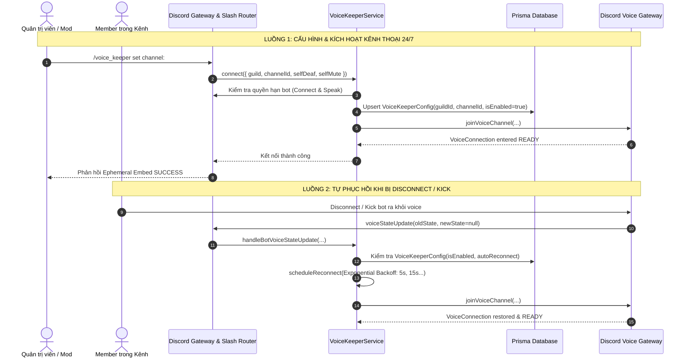

# ĐẶC TẢ YÊU CẦU TÍNH NĂNG (FEATURE REQUIREMENTS DOCUMENT - FRD)
## FEAT-04: VOICE KEEPER 24/7 (TREO KÊNH THOẠI & TỰ PHỤC HỒI)

---

### 1. MỤC TIÊU & BỐI CẢNH SỬ DỤNG THỰC TẾ

* **Bối cảnh:**
  Nhiều cộng đồng Discord có nhu cầu duy trì sự hiện diện liên tục của bot trong một kênh thoại cố định (Voice Channel hoặc Stage Channel) suốt 24/7 để tạo không khí hoạt náo, giữ kênh thoại luôn mở hoặc phục vụ các tính năng âm thanh/phòng chờ.
  Tuy nhiên, khi bot khởi động lại (update code, reboot server), khi Discord Voice Gateway rớt mạng tạm thời, hoặc khi bot bị thành viên vô tình disconnect/kick, bot thường bị mất kết nối và không tự quay trở lại, buộc Quản trị viên phải vào gõ lệnh thủ công.
* **Mục tiêu sản phẩm:**
  * **Tự Động Hóa 24/7 (Always-On Voice Presence):** Cho phép Quản trị viên chỉ định kênh thoại mục tiêu per-guild và bot tự động duy trì kết nối bền bỉ 24/7.
  * **Cơ Chế Tự Phục Hồi (Self-Healing & Auto-Recovery):**
    - Tự động kết nối lại khi bot khởi động lại thông qua Gateway Event `ClientReady`.
    - Tự động bắt sự kiện `voiceStateUpdate` để phát hiện ngay khi bot bị disconnect/kick ngoài ý muốn.
    - Tự động quay trở lại kênh đã cấu hình nếu bot bị move sang kênh khác.
    - Định kỳ rà soát qua Watchdog Cron Job (mỗi 10 phút) để khôi phục các kết nối bị đứt ngầm.
  * **Khả Năng Chống Quá Tải & Chống Spam Gateway (Circuit Breaker & Exponential Backoff):**
    - Khi kết nối thất bại liên tiếp (ví dụ kênh bị thu hồi quyền hoặc bot bị cấm vào), áp dụng hàng đợi retry với thời gian giãn cách: 5s, 15s, 45s, 90s, 180s.
    - Khi vượt quá 5 lần retry thất bại liên tiếp, ngắt hàng đợi và chuyển sang trạng thái `SUSPENDED` (Circuit Breaker kích hoạt) để tránh spam Discord API.
  * **Tiết Kiệm Tài Nguyên & Tối Ưu Băng Thông (Resource Efficiency):**
    - Tự động bật `selfDeaf: true` (điếc bot) và `selfMute: true` (tắt mic bot) để tiết kiệm băng thông UDP và tôn trọng quyền riêng tư của thành viên trong kênh thoại.

---

### 2. PHÂN QUYỀN TRUY CẬP (RBAC MATRIX)

| Vai trò | Điều kiện Xác thực | Quyền hạn trong Voice Keeper 24/7 |
| :--- | :--- | :--- |
| **Server Administrator** | `PermissionFlagsBits.Administrator` | Toàn quyền thiết lập (`set`), ép kết nối lại (`reconnect`), dừng (`stop`) và xem trạng thái (`status`). |
| **Channel Moderator** | `PermissionFlagsBits.ManageChannels` | Toàn quyền thiết lập (`set`), ép kết nối lại (`reconnect`), dừng (`stop`) và xem trạng thái (`status`). |
| **Thành viên thường (@everyone)** | Mọi thành viên trong Guild | Chỉ được phép xem trạng thái (`status`) của hệ thống Voice Keeper trong Guild. |

---

### 3. QUY TRÌNH VẬN HÀNH & LUỒNG DỮ LIỆU (USER JOURNEYS)

---

### 4. ĐẶC TẢ BỘ LỆNH SLASH (`/voice_keeper`)

* **Lệnh Cấp Cao (Root Command):** `/voice_keeper`
* **Subcommands:**
  1. `/voice_keeper set <channel> [self_deaf] [self_mute] [auto_reconnect]`
     - Thiết lập và kích hoạt kênh thoại 24/7 cho server.
     - Kiểm tra quyền hạn của bot trong kênh đích.
  2. `/voice_keeper status`
     - Hiển thị thông tin kênh thoại, trạng thái kết nối (`Connected`, `Reconnecting`, `Suspended`, `Disabled`), uptime, latency và số lần retry.
  3. `/voice_keeper reconnect`
     - Ép buộc bot ngắt kết nối cũ và tham gia lại kênh thoại mục tiêu ngay lập tức.
  4. `/voice_keeper stop`
     - Ngắt kết nối voice và cập nhật `isEnabled = false` trong DB.

---

### 5. TIÊU CHÍ CHẤP THUẬN (ACCEPTANCE CRITERIA)

1. **AC-01 (Cấu hình thành công):** Khi Admin gõ `/voice_keeper set #channel`, bot kiểm tra quyền `Connect`/`Speak`. Nếu đủ quyền, bot tham gia vào kênh, cập nhật DB và phản hồi Embed thông báo xanh.
2. **AC-02 (Tự động nạp khi khởi động):** Khi bot restart (`ClientReady`), hệ thống tự động quét tất cả các guild có `isEnabled = true` trong `VoiceKeeperConfig` và khôi phục kết nối.
3. **AC-03 (Bắt sự kiện Disconnect):** Khi bot bị đá ra khỏi kênh, hệ thống lập tức lên lịch reconnect và tự động vào lại kênh thoại.
4. **AC-04 (Circuit Breaker):** Khi không thể kết nối lại sau 5 lần thử liên tiếp, bot dừng retry và chuyển trạng thái sang `SUSPENDED` kèm ghi log warning.
5. **AC-05 (Channel Delete):** Nếu kênh thoại đang treo bị xóa khỏi server, bot tự động hủy cấu hình và dừng treo an toàn, không rơi vào vòng lặp vô tận.
6. **AC-06 (Graceful Shutdown):** Khi bot nhận tín hiệu `SIGINT`/`SIGTERM`, tất cả các VoiceConnection được hủy sạch sẽ trước khi thoát.
